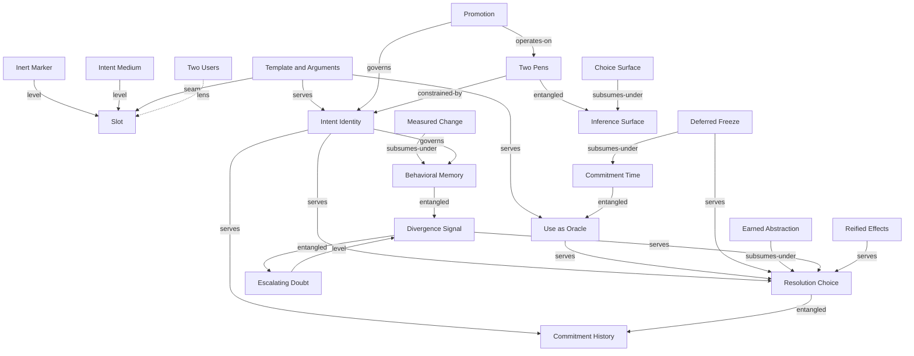

# Distillation of the Semiformal Concept Set

Working document. The goal is to reduce twenty-one candidate concepts to the core
of the core by mapping their relations, finding overlaps and level mismatches, and
iterating until the whole design space is legible. The final catalog lives in
`semiformal-concepts.md`. This document records how the set was reached.

## The twenty-one candidates

Specification. Slot, Inert Marker, Intent Medium, Template and Arguments, Intent
Identity.

Commitment. Commitment Time, Use as Oracle, Resolution Choice, Deferred Freeze,
Earned Abstraction.

Evolution. Commitment History, Divergence Signal, Escalating Doubt, Behavioral
Memory, Measured Change, Reified Effects.

Elicitation. Two Pens, Inference Surface, Choice Surface, Promotion, Two Users.

## Edge types used in the graph

- subsumes. A is general, B is a special case of A.
- serves. B is a mechanism in service of A.
- seam. A and B are the two sides of one boundary the design has to draw.
- entangled. A and B co-define each other and both earn a place.
- level. B is a tactic or dimension sitting one abstraction below A.

## Iteration 0. The full graph

Reading the graph, four things are visible immediately.

Some nodes sit a level below a neighbour and are tactics, not concepts. Inert Marker
and Intent Medium are dimensions of Slot. Escalating Doubt is a cost tactic under
Divergence Signal. Measured Change is one mechanism inside Behavioral Memory. Choice
Surface is a kind of Inference Surface. Deferred Freeze is a policy for choosing
Commitment Time. Earned Abstraction is one mode of Resolution Choice.

Some pairs are entangled and both earn a place. Commitment Time and Use as Oracle
co-define, since late timing exists so that use can supply evidence. Divergence
Signal and Behavioral Memory co-define, since the contract's checks are the very
signals that flag divergence. Two Pens and Inference Surface co-define the writing
surface.

Some nodes are hubs. Resolution Choice consumes Identity, Divergence, History, and
evidence. Intent Identity is consumed by History, Resolution, Memory, and Promotion.

One node is a different kind of thing. Two Users is a framing lens over the whole
graph, not a mechanism inside it.

## Iteration 1. Fold the tactics and special cases into their parents

- Inert Marker, Intent Medium fold into Slot.
- Escalating Doubt folds into Divergence Signal.
- Measured Change folds into Behavioral Memory.
- Choice Surface folds into Inference Surface.
- Deferred Freeze folds into Commitment Time.
- Earned Abstraction folds into Resolution Choice.

Remaining nodes, fifteen. Slot, Template and Arguments, Intent Identity, Commitment
Time, Use as Oracle, Resolution Choice, Commitment History, Divergence Signal,
Behavioral Memory, Reified Effects, Two Pens, Inference Surface, Promotion, Two
Users.

## Iteration 2. Merge the co-defining pairs into single concepts

- Commitment Time plus Use as Oracle become one concept, Deferred Commitment. Timing
  and evidence are two faces of one decision, to commit at use so that use supplies
  the evidence.
- Divergence Signal plus Behavioral Memory stay distinct after a hard look. Divergence
  is checking one mechanism against the current input. Memory is carrying reasons and
  constraints across regenerations. They meet, since a contract check is a divergence
  test, and the shared machinery is real, yet they answer different questions. The
  entanglement is kept and named instead of merged.
- Two Pens plus Inference Surface plus Promotion collapse into one concept, Gradual
  Formalization. The dual channel and the surfaced inference exist so that a human can
  promote an inference into a commitment. The mechanism only means something as a
  whole.
- Reified Effects generalizes into Trusted Effect Gate, the principle that an
  untrusted mechanism's consequences pass through a trusted inspectable layer before
  reaching the world.

Remaining, ten. Slot, Template and Arguments, Intent Identity, Deferred Commitment,
Resolution Choice, Commitment History, Divergence Signal, Behavioral Memory, Trusted
Effect Gate, Gradual Formalization. Plus Two Users as a lens.

## Iteration 3. Sort the ten into abstraction levels

Writing the ten on one line hides that they are not peers. They stack.

- Substrate, what gets committed. Slot. Template and Arguments is the seam inside the
  slot between durable intent and transient evidence, so it is a facet of Slot rather
  than a peer.
- The act, how intent turns into mechanism. Deferred Commitment.
- Management of a commitment over time. Intent Identity, Commitment History,
  Resolution Choice, Behavioral Memory. Divergence Signal is the verification step
  inside Resolution and inside Memory, so it drops as a peer and lives inside both.
- Interfaces, where the informal program meets a human and the world. Gradual
  Formalization, Trusted Effect Gate.
- Lens over all layers. Two Users.

Folding Template and Arguments into Slot and Divergence Signal into Resolution and
Memory leaves eight mechanism concepts plus one lens.

## Iteration 4. Test each survivor for definitional necessity and settle the core

The test is whether removing the concept turns semiformal programming back into
ordinary programming or into a bare model call.

- Slot. Removing it removes partial specification. Definitional.
- Deferred Commitment. Removing it commits everything up front, which is ordinary
  programming. Definitional.
- Intent Identity. Removing it regenerates on every call, which is a chatbot in a
  loop. Definitional, and it is the hub the other management concepts hinge on.
- Resolution Choice. Removing it freezes the first mechanism forever, which is a
  cache over one model call. Definitional, since evolution is the claim.
- Behavioral Contract, the renamed Behavioral Memory. Removing it lets evolution
  regress in silence. Definitional for a system meant to be trusted.
- Gradual Formalization. Removing it removes the dial between informal and formal,
  which is the semi in semiformal. Definitional.
- Commitment History. Removing it keeps a working system that cannot roll back or
  audit its own autonomous edits. Important, and it is the store that Resolution and
  Contract operate on, so it reads as the substrate of the management layer more than
  an independent claim. Second ring.
- Trusted Effect Gate. Removing it is fine for pure functions and only matters once
  the program acts on the world. An extension for a class of programs. Second ring.

The definitional core is six. Slot, Deferred Commitment, Intent Identity, Resolution
Choice, Behavioral Contract, Gradual Formalization. Two second-ring concepts extend
it, Commitment History as the store beneath the management layer, and Trusted Effect
Gate as the world-facing boundary. Two Users stays a lens.

Key entanglements to state rather than dissolve. Intent Identity is the hub, since a
change of intent mints a new identity, which retires the contract, opens a fresh
history, and is exactly what Promotion triggers. Resolution and History are two
halves of one act, the decision and the store it reads and writes. Divergence lives
inside both Resolution and Contract as the shared act of checking.

Drafting of the six core writeups now proceeds in `semiformal-concepts.md`, after
which one last pass revisits the boundaries that writing exposes.

## Iteration 5. Adjustments the writing forced

Recorded after the six core writeups, the two extending writeups, and the lens were
actually drafted in `semiformal-concepts.md`. These are what the prose exposed, not
what was predicted before drafting.

- The clean split between Deferred Commitment and Resolution Choice held, and drafting
  showed why the boundary is fragile. The first commitment is the generate branch of
  resolution seen under a deferral policy, so the two entries slid toward each other
  until the word commit was struck from Resolution and each concept was scoped to one
  question, when a mechanism is born and on what evidence for the former, what to do
  when a mechanism already exists for the latter. The division is real but has to be
  defended in the wording, which is a sign the two sit closer than any other pair in
  the core.
- The intent and evidence seam turned out to recur far more widely than Iteration 3
  assumed. It is introduced in Slot, is the precondition for sameness in Intent
  Identity, sets how much evidence a first commitment can draw on in Deferred
  Commitment, and decides what counts as a matching input in Resolution Choice. A
  facet that surfaces in four of the eight mechanism concepts behaves less like a
  facet and more like a cross-cutting seam, closer in kind to the Two Users lens than
  to a dimension of Slot. It is left inside Slot rather than promoted, since it has no
  standalone mechanism and promoting it would break the core-of-the-core aim, but the
  recurrence is the genuine finding and every entry that relies on it now names it.
- The re-verification check behaved the same way. Drafting placed it inside Resolution
  Choice as the confirmation of a reuse, inside Behavioral Contract as the assertion
  that survives a rewrite, and inside Deferred Commitment as the held out
  generalization that licenses a freeze. Three appearances confirm the Iteration 3
  decision to treat it as a shared act rather than a peer concept, and confirm that
  Divergence Signal was correctly dissolved rather than merged.
- Identity neutrality of machine writing appears in both Intent Identity and Gradual
  Formalization. It is fundamentally an identity rule, so it is stated as the last
  hazard of Intent Identity and referenced from Gradual Formalization rather than
  restated. This is a deliberate shared edge, not a redundancy to remove.
- Commitment History and Behavioral Contract read as two memories with different jobs,
  one of mechanisms and their lineage, one of constraints and their reasons. History
  earned core-depth treatment despite its second-ring status, and is marked as the
  substrate of the management layer.
- Trusted Effect Gate depends on the mechanism, not on the resolution decision. The
  Iteration 0 edge from Resolution Choice to Reified Effects overstated the coupling.
  The gate sits downstream of whatever mechanism a slot commits to, regardless of
  which resolution path produced it, so it is drawn from Resolution in the top map
  only as the nearest management node and is described in its own entry without
  reference to the choice.

No concept was added, removed, or renamed by the drafting pass. The set stands at six
definitional concepts, two extending concepts, and one lens. The two boundaries the
writing stressed, Deferred Commitment against Resolution Choice and the seam against
Slot, are recorded here as the places a future redesign is most likely to redraw.
