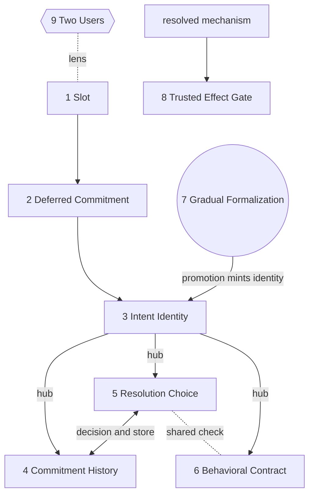

# Semiformal Concepts as Design Guidelines

This document presents the core concepts of semiformal programming as a set of design
guidelines, each stated as a principle, grounded in prior work, and closed by the
symptom that reveals a wrong choice. The concepts and the reduction that produced them
are recorded in `semiformal-concepts-distillation.md`; here they are laid out the way
Shipman and Marshall laid out approaches to the problems of formalisms, as guidance a
designer can act on rather than an architecture to copy (Shipman & Marshall, 1999).

## The guidelines

Building a system that keeps part of a program informal has no single remedy. The nine
concepts below function as guidelines, each answering one recurring pressure and each
anchored in a line of prior work. Six are definitional, in that removing any one returns
the paradigm to ordinary programming or to a bare sequence of model calls. Three extend
the core, one beneath it as the store the others read, one beside it as the boundary to
the world, and one as a lens over all of them.

1. Keep the hole a first-class element of the host language rather than a string handed
   to a generator.
2. Defer the mechanism of a hole to first use and let runtime evidence shape it.
3. Ground the identity of a hole in its intent rather than its position.
4. Keep the record of past commitments as a navigable history rather than a cache.
5. Treat every later encounter with a resolved hole as an ordered choice among reuse,
   adaptation, and rewrite.
6. Defend behavior across rewrites with properties and remembered reasons rather than
   fixed expected outputs.
7. Move each hole from informal toward formal one endorsed decision at a time.
8. Route any effect on the world through an inspectable, trusted layer.
9. Design every mechanism for two readers at once, the author of intent and the consumer
   of the artifact.

## The design space in layers

The nine are not peers. They stack, and reading them on one line hides that.

Substrate is what gets committed, guideline 1. The act is how intent turns into a
mechanism, guideline 2. Management of a commitment over time holds guidelines 3 through
6, with Intent Identity as the hub, since a change of intent mints a new identity, which
retires the contract, opens a fresh history, and is exactly what promotion triggers.
Resolution Choice and Commitment History are two halves of one act, the decision and the
store it reads and writes. The check that a mechanism still holds lives inside both
Resolution Choice and Behavioral Contract. Interfaces are where the informal program
meets a human and the world, guidelines 7 and 8. Guideline 9 is a lens over all of them.

---

## Substrate

### 1. Keep the hole first-class in the host (Slot)

Every system that leaves part of a program unwritten has to decide what a hole is and how
much of a program one may span. Typed holes in Hazel preserve well-typedness around a
missing subexpression so an incomplete program stays analyzable and runnable (Omar et
al., 2017), and program sketching lets a programmer leave holes for a solver to fill
(Solar-Lezama, 2009). Both treat the hole as a construct the language understands, which
is what keeps a half-written program alive. The width of the grammar of holes trades
reach against verifiability, since the more of a program that may stay informal the harder
it becomes to state what each hole must return, a tension visible in the move from
expression-level holes to whole natural-language specifications, where formalizing the
language tends to reproduce the rigidity it was meant to escape (Dijkstra, 1979; Sammet,
1966) and the resulting abstraction can conceal the decisions that most need attention
(Steimann, 2018). Two dimensions sit inside the hole. The medium of the intent, whether
prose, examples, a type, or handwritten notation, fixes some of the goal and leaves the
rest open, and richer media draw out a better mechanism while making two intents harder
to compare (Green, 1989; Arawjo et al., 2022; Lindenbaum et al., 2022). The embedding in
the host decides whether an unfilled program still parses, which is why a marker the host
already discards keeps incremental work possible. A sound design widens the grammar of
holes only as far as it can still name each hole's obligation, expresses intent in the
smallest medium that pins the goal, and embeds the hole with a marker the host ignores. A
program that stops parsing before every hole is filled has chosen an embedding that blocks
incremental adoption. A hole whose obligation cannot be stated has been allowed to span
more than the design can later verify.

---

## The act

### 2. Defer the mechanism to first use (Deferred Commitment)

Ordinary programs fix every mechanism before they run, and the defining move of the
paradigm postpones the mechanism of a hole until it is first reached with real data, the
strategy named directly in Thimbleby's account of delaying commitment (Thimbleby, 1988)
and motivated by the observation that the distinctions a program must draw often surface
only at runtime (Petricek, 2021). The reason is evidence. A mechanism written in advance
handles inputs the author imagined, while a mechanism written at first use is shaped by
the values actually present, the same principle that lets program-by-example systems infer
a transformation from concrete demonstrations (Gulwani, 2011; Wang et al., 2021) and lets
library-learning systems grow abstractions from observed programs (Ellis et al., 2021).
Timing and evidence are one decision seen from two sides, since the only reason to commit
late is to let use supply the evidence, and the amount of surrounding context gathered
before committing sets how well the first mechanism generalizes. This late commitment
separates the paradigm from declarative frameworks that keep a prompt in source but
re-execute it at every invocation (Khattab et al., 2023; Beurer-Kellner et al., 2023;
Zheng et al., 2024), where the specification is consumed anew each call rather than
committed once to a durable artifact. Some holes resist any fixed mechanism, and whether a
hole is compilable at all is discovered empirically by running it interpreted and freezing
it into fixed code only once it reproduces cases it was never shown. A sound design defers
each hole's mechanism to first use, gathers as much real evidence as the call site
affords, and treats the freeze into fixed code as an empirical event licensed by held out
generalization. A hole frozen on its single first example tends to overfit the second
input. A hole that never reproduces held out cases and is frozen regardless is one the
design mistook for compilable.

---

## Management of a commitment over time

### 3. Ground identity in intent (Intent Identity)

Deciding when two holes are the same thing looks like a hashing detail and operates as the
rule that sets what an edit costs. Content-addressed identity, where a value is named by a
hash of what it contains (Merkle, 1987), gives a stable handle, and the design choice is
what to feed the hash. Identity keyed on physical location discards a working mechanism
the moment a line moves, which reads as arbitrary to the person editing, while identity
grounded in the authored intent matches the sense that reformatting leaves a program's
meaning intact, a view of the program as an evolving theory held by its author (Naur,
1985). Two identities do two jobs, one that pins a hole to its own history in a single
place, and one keyed over meaning and shape so that two holes expressing the same intent
in different files share a single mechanism. A hazard arrives once the system writes its
own inferences back into the source, since those machine lines have to stay outside
identity, or annotating a hole changes it and the annotation repeats without end. A sound
design grounds identity in the human's intent scoped to its enclosing structure, drops
everything positional, keeps a second meaning-level key so equivalent intents share work,
and excludes machine-written lines from both. A developer who reformats code and loses a
mechanism has watched position leak into identity. The same intent in two files paying
full generation cost twice shows that no meaning-level key exists.

### 4. Keep a history, not a cache (Commitment History)

Treating generated code as a cache entry invites overwriting it on every change, which
discards the record of what was tried and why it was abandoned. The durable object worth
keeping is a trail of decisions, structured so that a superseded mechanism and its reason
for leaving service both remain, which a content-addressed chain of commits supports
(Merkle, 1987) and which a program understood as an accumulated theory requires (Naur,
1985). The distinction that carries weight is the fork against the step. A step is the
same approach corrected and supersedes what came before, while a fork is a materially
different approach kept in parallel because either might prove right for a different input
shape. A history also licenses an autonomous system to change its own behavior, since it
supports rolling back a poor automatic edit and showing that nothing regressed, and it is
what lets one hole be recompiled while the rest of a running program continues (Litt et
al., 2025) or a whole pipeline keep versions as it improves itself (Khattab et al., 2023).
A sound design fixes one rule for which mechanism is active when several coexist, branches
on adaptation so a correction never destroys what it corrects, and preserves every retired
mechanism with the reason it left. Inability to reconstruct from the record why a hole
produces one output today and produced another last week shows the structure has become a
cache with no history.

### 5. Make resolution an ordered choice (Resolution Choice)

Once a mechanism exists for a hole, every later call chooses among reusing it, adapting
it, and rewriting it, and reducing that choice to a cache hit or a full regeneration is
what makes naive systems thrash, since each correction then discards what the previous
mechanism learned and competence oscillates instead of accumulating. The middle option
carries the weight. Adaptation hands a mechanism its own failing case and turns a run of
failures into a converging mechanism, the same incremental refinement that self-improving
pipelines and agentic query rewriters perform when they revise a program rather than
replace it (Khattab et al., 2023; Shankar et al., 2024). The choice has to be one ordered
rule applied identically on every call, because an ad hoc choice produces nondeterminism a
developer cannot reproduce. Reuse itself stays a hypothesis until the mechanism is
confirmed against the actual input, the discipline that constrained decoding applies when
it forces output to satisfy a schema before accepting it (Willard & Louf, 2023; Scholak et
al., 2021). A sound design expresses the choice as one ordered function, defaults to
adaptation whenever a mechanism exists and fails, reserves rewrite for a changed
specification or a mechanism worth abandoning, and re-verifies every reuse on the real
input with checks ordered cheap before expensive so the common case costs almost nothing.
A hole that flips between two implementations across identical runs signals rewriting
where adaptation belonged. A hole that serves visibly stale output signals reuse without
re-verification.

### 6. Defend behavior with contracts and remembered reasons (Behavioral Contract)

The defining hazard of a system that rewrites itself is regression by omission, where a
fix for one input breaks another the new mechanism never learned about. A conventional
test suite assumes known expected outputs, and informal intent rarely supplies them, since
nothing states what a request to summarize a passage ought to return. The workable
response asserts the properties an answer must hold and the relations it must obey, a
discipline with a long lineage in design by contract (Meyer, 1992) and behavior-driven
specification (North, 2006), extended by metamorphic relations that check how an output
must change when the input is transformed (Chen et al., 1998) rather than pinning one
output. Such assertions survive a rewrite that phrases the answer differently, where a
fixed pair of input and output would raise a false alarm, and they connect to the emerging
effort to verify model-generated code against stated properties (Councilman et al., 2025).
The deeper role is memory. Carrying the reason a past decision was made into the next
rewrite, so the next generation learns that a mechanism exists because one format once
failed, keeps the system from circling back over ground it already covered, which
higher-order contracts formalize by assigning blame across the boundary a value crosses
(Findler & Felleisen, 2002). A sound design accumulates properties and relations per hole,
pins exact examples only for small canonical output spaces, feeds the reason a failed
check exists into the rewrite, and seeds each check from the current mechanism's own
behavior so it holds the moment it is written. Checks that fire on correct answers worded
differently reveal examples pinned where properties belonged. A fix that silently moved a
valued output reveals a memory too thin to defend it.

---

## Interfaces

### 7. Turn the dial one endorsed decision at a time (Gradual Formalization)

The word semi names a dial, and the human loop turns it from informal toward formal one
decision at a time, the incremental formalization that Shipman and Marshall proposed to
let people enter information loosely and structure it later, with the system suggesting
formalizations the user may accept, modify, reject, or ignore (Shipman & Marshall, 1999).
The type-theoretic form of the same dial is gradual typing, where a program moves between
dynamic and static checking one annotation at a time (Siek & Taha, 2006). The source
therefore carries two kinds of writing, the commitments a human owns and the inferences
the system proposes, kept in visibly distinct channels so authorship of any line is never
in doubt, and the machine channel stays outside the hole's identity so that annotating a
hole does not redefine it. What the system surfaces is held to a small fixed vocabulary a
human can scan, since structured reasoning traces read more legibly than generated code
alone (Chen et al., 2022; Wei et al., 2022), though a stated rationale can be causally
disconnected from the mechanism actually chosen (Jacovi & Goldberg, 2020; Turpin et al.,
2023; Lanham et al., 2023), which is why the surface serves as a prompt for human judgment
and the endorsement is what counts. The loop closes with promotion, where a human rewrites
an inference they endorse as their own commitment, which changes the intent, mints a new
identity, and raises the system's obligation, the editable-explanation move that lets a
user correct a system's account and have the correction take effect (Tian et al., 2023),
an instance of pairing human agency with automation rather than letting one replace the
other (Heer, 2019). A sound design gives human and machine disjoint channels, keeps the
machine channel identity-neutral, surfaces inferences and open decisions in a vocabulary
that earns each line, and offers one gesture that promotes an inference into a commitment.
A surface no one reads has failed to earn its lines. A promotion that fails to raise the
system's obligation shows the loop between inference and commitment is broken.

### 8. Route effects through a trusted gate (Trusted Effect Gate)

A generated mechanism is not trusted, and the stakes rise when its output is an action on
the world rather than a value, since a wrong value can be checked and discarded while a
wrong deletion cannot be recalled. Losing the ability to inspect code, as one expert put
it during the design of the paradigm, means the balance has to be tipped back by some
compensating way to trust the result. The response keeps the mechanism from acting
directly and has it describe the intended action as inspectable data that a trusted layer,
written by hand and never generated, reviews before anything takes effect, the same
reification of actions into first-class examinable objects that concept-oriented systems
adopt to keep behavior legible and interoperable (Henderson et al., 2025). That layer
rehearses the action against a faithful copy so the mechanism can branch on real state
without risk, bounds the damage before anything fires, and applies it only under approval,
which extends the precondition discipline of contracts from inputs to consequences (Meyer,
1992; Findler & Felleisen, 2002) and aligns with the effort to verify generated code
before trusting it (Councilman et al., 2025). Reversibility divides the field. For an
action with an inverse the layer captures the exact inverse at the moment of acting so
undo replays what was done instead of re-deriving it from code that may since have changed,
and for an action with no inverse the design substitutes idempotency and an explicit human
gate. A sound design routes every world-touching action through reified data and a trusted
reviewer, proves or bounds its blast radius before it fires, and records a captured inverse
for anything it means to be able to revert. An effect that fired straight from generated
code has bypassed the gate. A revert that recomputes its inverse from the current mechanism
can undo something other than what it did.

---

## Lens

### 9. Design for two readers at once (Two Users)

A semiformal system serves two audiences whose needs pull in opposite directions, the
developer who authors intent and the person who consumes the artifact the program
produces. The developer wants a surface that is live, forgiving, and promotable, the kind
of user agency malleable-software research seeks to restore (Litt et al., 2025), while the
consumer wants a mechanism that is stable, readable, and trustworthy without any knowledge
of the apparatus that produced it. The reconciling test is whether the consumer can rely
on the output while trusting nothing about the generator, which holds only when the
produced mechanism stays ordinary inspectable code carrying its own evidence of
verification, the persistent and revisable artifact that treating prompts as real program
elements demands (Liang et al., 2025; Naur, 1985) and that studies of code-generation
tools find users struggle to trust while it stays opaque (Vaithilingam et al., 2022; Barke
et al., 2022). A design that meets the developer's need for fluidity by making the output
an opaque model call has failed the consumer. A design that meets the consumer's need for
stability by freezing the developer's surface has failed the author. The lens applies to
every other guideline, since each is read once by the author while writing and once by the
consumer through the artifact it leaves behind.

---

## References

Arawjo, I., DeArmas, A., Roberts, M., Basu, S., & Parikh, T. (2022). Notational
Programming for Notebook Environments: A Case Study with Quantum Circuits. UIST '22.

Barke, S., James, M. B., & Polikarpova, N. (2022). Grounded Copilot: How Programmers
Interact with Code-Generating Models. arXiv:2206.15000.

Beurer-Kellner, L., Müller, M. N., Fischer, M., & Vechev, M. (2023). Prompt sketching for
large language models. arXiv:2311.04954.

Chen, T. Y., Cheung, S. C., & Yiu, S. M. (1998). Metamorphic testing: a new approach for
generating next test cases. Technical Report HKUST-CS98-01.

Chen, W., Ma, X., Wang, X., & Cohen, W. W. (2022). Program of Thoughts Prompting.
arXiv:2211.12588.

Councilman, A., Fu, D., Gupta, A., Wang, C., Grove, D., Wang, Y.-X., & Adve, V. (2025).
Towards Formal Verification of LLM-Generated Code from Natural Language Prompts.
arXiv:2507.13290.

Dijkstra, E. W. (1979). On the foolishness of "natural language programming". In Program
Construction, LNCS 69, 51–53.

Ellis, K., Wong, C., Nye, M., et al. (2021). DreamCoder: Growing generalizable,
interpretable knowledge with wake-sleep Bayesian program learning. PLDI.

Findler, R. B., & Felleisen, M. (2002). Contracts for higher-order functions. ICFP '02.

Green, T. R. G. (1989). Cognitive dimensions of notations. People and Computers V.

Gulwani, S. (2011). Automating string processing in spreadsheets using input-output
examples. POPL.

Heer, J. (2019). Agency plus automation: Designing artificial intelligence into
interactive systems. PNAS 116(6), 1844–1850.

Henderson, T., Karger, D. R., & Clark, D. D. (2025). Graffiti: Enabling an Ecosystem of
Personalized and Interoperable Social Applications. UIST '25.

Jacovi, A., & Goldberg, Y. (2020). Towards faithfully interpretable NLP systems. ACL.

Khattab, O., Singhvi, A., Maheshwari, P., et al. (2023). DSPy: Compiling declarative
language model calls into self-improving pipelines. arXiv:2310.03714.

Lanham, T., Chen, A., Radhakrishnan, A., et al. (2023). Measuring faithfulness in
chain-of-thought reasoning. Anthropic Research.

Liang, J. T., Lin, M., Rao, N., & Myers, B. A. (2025). Prompts Are Programs Too!
Understanding How Developers Build Software Containing Prompts. Proc. ACM Softw. Eng. 2, FSE.

Lindenbaum, J., Kaliski, S., & Horowitz, J. (2022). Inkbase: Programmable Ink. Ink &
Switch.

Litt, G., Horowitz, J., van Hardenberg, P., & Matthews, T. (2025). Malleable Software:
Restoring User Agency in a World of Locked-Down Apps. Ink & Switch.

Merkle, R. C. (1987). A digital signature based on a conventional encryption function.
CRYPTO.

Meyer, B. (1992). Applying "Design by Contract". Computer 25(10), 40–51.

Naur, P. (1985). Programming as theory building. Microprocessing and Microprogramming
15(5), 253–261.

North, D. (2006). Introducing BDD. Better Software.

Omar, C., Voysey, I., Hilton, M., Aldrich, J., & Hammer, M. A. (2017). Hazelnut: a
bidirectionally typed structure editor calculus. POPL.

Petricek, T. (2021). Programming as architecture, design, and urban planning. Onward!

Sammet, J. E. (1966). The use of English as a programming language. Commun. ACM 9(3),
228–230.

Scholak, T., Schucher, N., & Bahdanau, D. (2021). PICARD: Parsing Incrementally for
Constrained Auto-Regressive Decoding from Language Models. EMNLP.

Shankar, S., Chambers, T., Shah, T., Parameswaran, A. G., & Wu, E. (2024). DocETL: Agentic
query rewriting and evaluation for complex document processing. arXiv:2410.12189.

Shipman, F. M., & Marshall, C. C. (1999). Formality Considered Harmful: Experiences,
Emerging Themes, and Directions on the Use of Formal Representations in Interactive
Systems. CSCW 8(4), 333–352.

Siek, J. G., & Taha, W. (2006). Gradual typing for functional languages. Scheme and
Functional Programming Workshop.

Solar-Lezama, A. (2009). The sketching approach to program synthesis. APLAS.

Steimann, F. (2018). Fatal abstraction. Onward!

Thimbleby, H. (1988). Delaying commitment (programming strategy). IEEE Software 5(3),
78–86.

Tian, Y., Zhang, Z., Ning, Z., Li, T. J.-J., Kummerfeld, J. K., & Zhang, T. (2023).
Interactive text-to-SQL generation via editable step-by-step explanations. EMNLP.

Turpin, M., Michael, J., Perez, E., & Bowman, S. R. (2023). Language models don't always
say what they think: Unfaithful explanations in chain-of-thought prompting. NeurIPS.

Vaithilingam, P., Zhang, T., & Glassman, E. L. (2022). Expectation vs. Experience:
Evaluating the Usability of Code Generation Tools Powered by Large Language Models. CHI.

Wang, C., Feng, Y., Bodik, R., Dillig, I., Cheung, A., & Ko, A. J. (2021). Falx:
Synthesis-powered visualization authoring. CHI.

Wei, J., Wang, X., Schuurmans, D., et al. (2022). Chain-of-thought prompting elicits
reasoning in large language models. NeurIPS.

Willard, B. T., & Louf, R. (2023). Efficient guided generation for large language models.
arXiv:2307.09702.

Zheng, L., Yin, L., Xie, Z., et al. (2024). SGLang: Efficient execution of structured
language model programs. NeurIPS.
